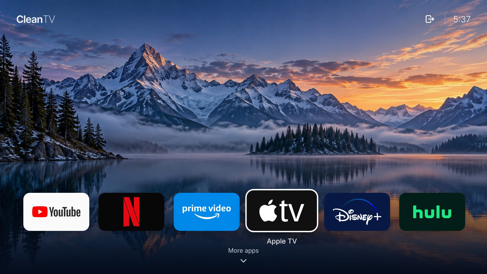
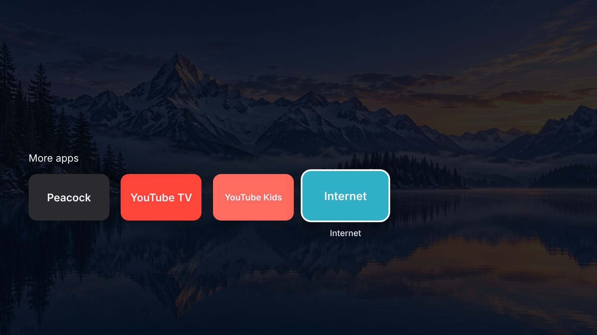
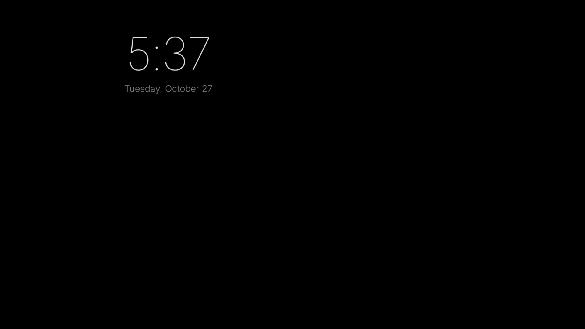
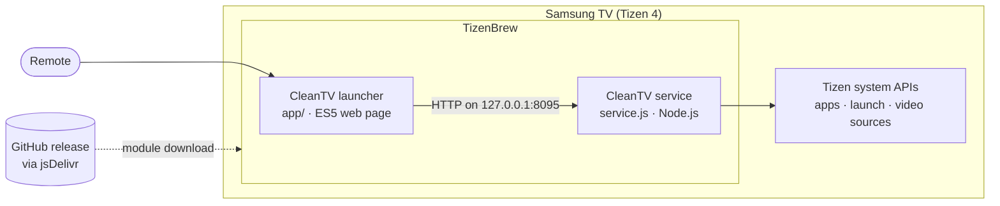

# CleanTV

**An ad-free, Apple TV–style home screen for Samsung smart TVs.**

Samsung's built-in home bar is crowded with ads, sponsored rows and apps nobody asked for. CleanTV replaces it with a calm, cinematic launcher: your favourite streaming apps, a clock, and nothing else. It runs on a 2018 Samsung TV (Tizen 4) without rooting the TV or modifying its firmware.



## Features

- **Cinematic home:** full-screen landscape scenery that slowly crossfades, with a clean dock of six favourite apps.
- **Built for the remote:** move with the arrows, open with OK. The selected tile lifts, and its name appears underneath.
- **More apps:** press Down for a second row. It shows the apps you choose, plus any app you install from Samsung's store. System services and promoted apps are filtered out.
- **Inputs picker:** press Up for the Inputs button, which lists the TV's HDMI sources.
- **Clock screensaver:** after five idle minutes, a thin clock drifts over black.
- **Easy exit:** Back returns to the first tile. Pressing Back twice more hands over to Samsung's home screen.
- **No ads and no tracking:** all artwork is bundled; the launcher makes no network calls of its own.

| More apps | Clock screensaver |
| --- | --- |
|  |  |

## How it works

Samsung TVs only install apps signed with a Samsung certificate tied to the specific TV. On this 2018 model, every package signed today is rejected (`install failed[118012]`, *invalid certificate chain*). The TV's 2018 firmware doesn't trust the certificate authorities Samsung currently issues developer certificates from. So CleanTV doesn't install as a standalone app. It runs as a module inside [TizenBrew](https://github.com/reisxd/TizenBrew), an open-source loader that is already trusted on the TV and loads modules straight from GitHub.

TizenBrew modules are web pages, and web pages can't call the TV's system APIs. CleanTV is therefore split in two:



| Part | Role |
| --- | --- |
| `app/` | The launcher UI. Plain ES5 JavaScript and CSS that runs on the TV's 2018 Chromium-based browser engine (no CSS grid, no blur effects). |
| `service.js` | Runs in TizenBrew's background Node.js service, which has access to the `tizen` APIs. Serves a localhost-only API to the launcher. |
| `app/js/apps.js` | All user settings: dock apps, More apps, hidden apps, screensaver, backgrounds. |

### Service API (localhost only)

| Endpoint | Purpose |
| --- | --- |
| `GET /status` | Service health and recent errors |
| `GET /apps` | Installed apps (`id`, `name`, `show`) |
| `GET /launch?id=APPID` | Open an app (falls back to an app-control launch) |
| `GET /sources` | HDMI and other video sources, with connection state |
| `GET /source?type=HDMI&number=1` | Switch to a video source |

## Install

You need a Samsung TV with **Developer Mode** turned on and **TizenBrew** installed. See the [TizenBrew guide](https://github.com/reisxd/TizenBrew/blob/main/docs/README.md) for both.

1. On the TV, set Developer Mode's **Host PC IP** to `127.0.0.1` and restart the TV. TizenBrew needs this to run its service.
2. Open **TizenBrew**, then the **Module Manager** (box icon, top right). Choose **Add GitHub module** and enter:
   ```
   ravi-gurram/cleantv@v1.3.1
   ```
3. Open **CleanTV** from TizenBrew's home screen.
4. Optional: in TizenBrew **Settings → Autolaunch**, pick **CleanTV**, so TizenBrew opens straight into it.

To update, remove the module, add it again with the new version tag, and restart the TV. If another module opens automatically, tap **Up** repeatedly while TizenBrew starts to get to its menu.

## Customise

Everything lives in [`app/js/apps.js`](app/js/apps.js):

| Setting | What it controls |
| --- | --- |
| `CLEANTV_DOCK` | The six favourites: name, logo, colours and app IDs (tried in order) |
| `CLEANTV_GRID` | Apps shown first under More apps |
| `CLEANTV_AUTO_APPS` | Also add store apps installed on the TV |
| `CLEANTV_HIDE` / `CLEANTV_RENAME` | Hide or rename auto-discovered apps |
| `CLEANTV_EXIT_TO` | Where Back goes when leaving CleanTV |
| `CLEANTV_SCREENSAVER_MINUTES` | Idle minutes before the clock screensaver (0 = off) |
| `CLEANTV_BACKGROUNDS` / `CLEANTV_BACKGROUND_SECONDS` | Scenery images and rotation interval (0 = no rotation) |

App IDs differ between TV models and regions. The ones here were read from a UN50NU6900. To list your TV's apps, connect with Samsung's `sdb` tool and run `sdb shell 0 applist`.

## Compatibility

| | |
| --- | --- |
| Tested on | Samsung UN50NU6900 (2018), Tizen 4.0 |
| Expected to work | Tizen 3.0+ TVs that can run TizenBrew (2017 onward) |
| Not tested on a TV yet | HDMI switching (depends on the permissions TizenBrew's service has), Back-to-exit target |

## Development

- **Preview in a desktop browser:** serve the repo (for example `python3 -m http.server`) and open `app/index.html?preview=1`. Preview mode disables device calls and labels launch attempts.
- **Tests:** `node tests/sources.js` and `node tests/input-ui.js` simulate the Tizen APIs and remote input. They don't certify TV performance or firmware compatibility.
- **Constraints:** keep `app/` to ES5 and CSS that Chromium 56 supports. The 2018 TV browser has no CSS grid, `backdrop-filter`, CSS variables or ES2015 syntax.

## Credits

- [TizenBrew](https://github.com/reisxd/TizenBrew) by reisxd, the module loader that makes this possible.
- Design inspired by [CleanYourTV](https://github.com/Gathin23/cleanyourtv) (Android TV) and the Apple TV home screen. Project idea from [CleanFrame](https://github.com/nthnclrk/CleanFrame).
- Asset sources and licences are listed in [ASSETS.md](ASSETS.md).

## Licence

[MIT](LICENSE). CleanTV is an independent personal project, not affiliated with or endorsed by Samsung or any streaming service. App names and logos are trademarks of their owners and are used only to identify the apps CleanTV opens.
